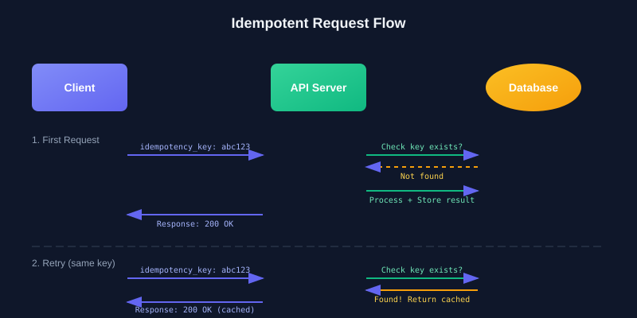
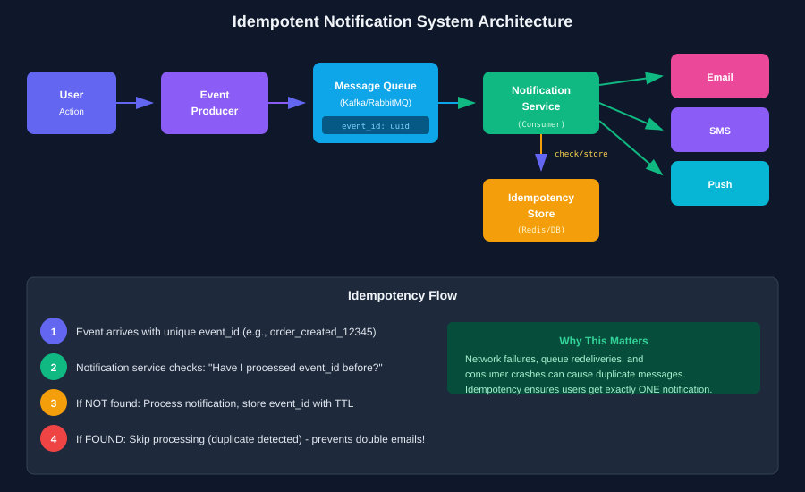
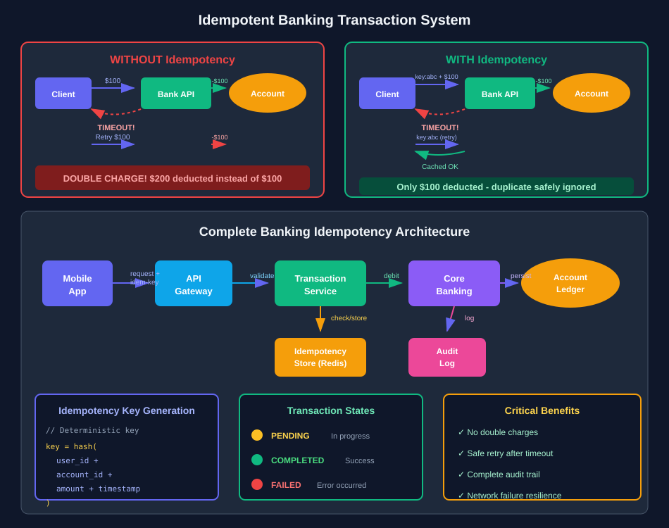
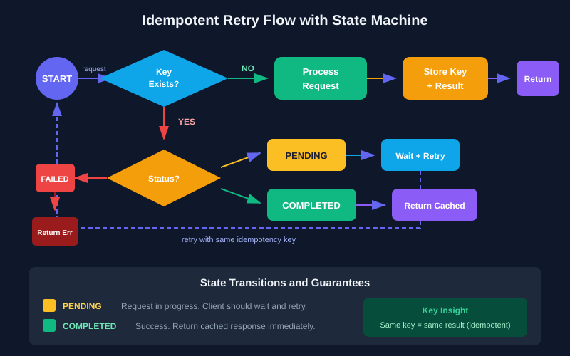

In distributed systems, things fail. Networks drop packets, services restart, and clients retry requests. Without careful design, these retries can cause duplicate actions — charging customers twice, sending the same email multiple times, or creating duplicate records. The idempotency design pattern is your defense against these reliability nightmares.

## What is Idempotency?

An operation is **idempotent** if performing it multiple times produces the same result as performing it once. Mathematically:

```
f(f(x)) = f(x)
```

In the context of APIs and distributed systems:

> **An idempotent operation can be safely retried without causing unintended side effects.**

Some operations are naturally idempotent:
- **GET requests** — Reading data doesn't change state
- **DELETE by ID** — Deleting the same resource twice still results in it being deleted
- **SET operations** — Setting a value to X, regardless of how many times, leaves it at X

But many operations are NOT naturally idempotent:
- **POST (create)** — Each call might create a new resource
- **Increment/decrement** — Each call changes the value
- **Sending notifications** — Each call triggers another message
- **Financial transactions** — Each call moves money

This is where the idempotency design pattern comes in.

## The Core Pattern

The idempotency pattern works by associating each request with a unique **idempotency key**. The server tracks which keys it has processed and their results.



Here's the flow:

1. **Client generates a unique idempotency key** (usually a UUID or deterministic hash)
2. **Client sends request** with the key in a header (e.g., `Idempotency-Key: abc123`)
3. **Server checks** if it has seen this key before
4. **If NOT found**: Process the request, store the key + result, return response
5. **If found**: Return the cached result immediately (no reprocessing)

### Implementation in Go

Here's a practical implementation using Redis for idempotency key storage:

```go
package idempotency

import (
    "context"
    "crypto/sha256"
    "encoding/hex"
    "encoding/json"
    "errors"
    "time"

    "github.com/redis/go-redis/v9"
)

type Status string

const (
    StatusPending   Status = "PENDING"
    StatusCompleted Status = "COMPLETED"
    StatusFailed    Status = "FAILED"
)

type CachedResponse struct {
    Status     Status          `json:"status"`
    StatusCode int             `json:"status_code"`
    Body       json.RawMessage `json:"body"`
    CreatedAt  time.Time       `json:"created_at"`
}

type Store struct {
    redis *redis.Client
    ttl   time.Duration
}

func NewStore(redis *redis.Client, ttl time.Duration) *Store {
    return &Store{redis: redis, ttl: ttl}
}

// Check returns the cached response if the key exists
func (s *Store) Check(ctx context.Context, key string) (*CachedResponse, error) {
    data, err := s.redis.Get(ctx, s.keyPrefix(key)).Bytes()
    if errors.Is(err, redis.Nil) {
        return nil, nil // Key doesn't exist
    }
    if err != nil {
        return nil, err
    }

    var resp CachedResponse
    if err := json.Unmarshal(data, &resp); err != nil {
        return nil, err
    }
    return &resp, nil
}

// Lock attempts to acquire a lock for processing
// Returns true if lock acquired, false if key already exists
func (s *Store) Lock(ctx context.Context, key string) (bool, error) {
    pending := CachedResponse{
        Status:    StatusPending,
        CreatedAt: time.Now(),
    }
    data, _ := json.Marshal(pending)

    // SET NX - only set if not exists
    ok, err := s.redis.SetNX(ctx, s.keyPrefix(key), data, s.ttl).Result()
    return ok, err
}

// Complete stores the final response
func (s *Store) Complete(ctx context.Context, key string, statusCode int, body []byte) error {
    resp := CachedResponse{
        Status:     StatusCompleted,
        StatusCode: statusCode,
        Body:       body,
        CreatedAt:  time.Now(),
    }
    data, _ := json.Marshal(resp)
    return s.redis.Set(ctx, s.keyPrefix(key), data, s.ttl).Err()
}

// Fail marks the request as failed
func (s *Store) Fail(ctx context.Context, key string, statusCode int, body []byte) error {
    resp := CachedResponse{
        Status:     StatusFailed,
        StatusCode: statusCode,
        Body:       body,
        CreatedAt:  time.Now(),
    }
    data, _ := json.Marshal(resp)
    return s.redis.Set(ctx, s.keyPrefix(key), data, s.ttl).Err()
}

func (s *Store) keyPrefix(key string) string {
    return "idempotency:" + key
}

// GenerateKey creates a deterministic key from request attributes
func GenerateKey(userID, action string, payload []byte) string {
    h := sha256.New()
    h.Write([]byte(userID))
    h.Write([]byte(action))
    h.Write(payload)
    return hex.EncodeToString(h.Sum(nil))[:32]
}
```

### HTTP Middleware

Here's middleware that wraps your handlers with idempotency protection:

```go
func IdempotencyMiddleware(store *Store) func(http.Handler) http.Handler {
    return func(next http.Handler) http.Handler {
        return http.HandlerFunc(func(w http.ResponseWriter, r *http.Request) {
            // Only apply to mutating methods
            if r.Method == http.MethodGet || r.Method == http.MethodHead {
                next.ServeHTTP(w, r)
                return
            }

            key := r.Header.Get("Idempotency-Key")
            if key == "" {
                http.Error(w, "Idempotency-Key header required", http.StatusBadRequest)
                return
            }

            ctx := r.Context()

            // Check if we've seen this request before
            cached, err := store.Check(ctx, key)
            if err != nil {
                http.Error(w, "Internal error", http.StatusInternalServerError)
                return
            }

            if cached != nil {
                switch cached.Status {
                case StatusCompleted, StatusFailed:
                    // Return cached response
                    w.Header().Set("X-Idempotency-Replayed", "true")
                    w.WriteHeader(cached.StatusCode)
                    w.Write(cached.Body)
                    return
                case StatusPending:
                    // Request is still being processed
                    w.Header().Set("Retry-After", "1")
                    http.Error(w, "Request in progress", http.StatusConflict)
                    return
                }
            }

            // Try to acquire lock
            locked, err := store.Lock(ctx, key)
            if err != nil {
                http.Error(w, "Internal error", http.StatusInternalServerError)
                return
            }
            if !locked {
                // Race condition - another request got the lock
                w.Header().Set("Retry-After", "1")
                http.Error(w, "Request in progress", http.StatusConflict)
                return
            }

            // Capture the response
            rec := &responseRecorder{ResponseWriter: w, statusCode: 200}
            next.ServeHTTP(rec, r)

            // Store the result
            if rec.statusCode >= 200 && rec.statusCode < 300 {
                store.Complete(ctx, key, rec.statusCode, rec.body.Bytes())
            } else {
                store.Fail(ctx, key, rec.statusCode, rec.body.Bytes())
            }
        })
    }
}

type responseRecorder struct {
    http.ResponseWriter
    statusCode int
    body       bytes.Buffer
}

func (r *responseRecorder) WriteHeader(code int) {
    r.statusCode = code
    r.ResponseWriter.WriteHeader(code)
}

func (r *responseRecorder) Write(b []byte) (int, error) {
    r.body.Write(b)
    return r.ResponseWriter.Write(b)
}
```

## Real-World Example: Notification System

Notification systems are particularly vulnerable to duplicates. A message queue might redeliver the same event due to consumer timeouts, network issues, or acknowledgment failures. Users receiving the same email, SMS, or push notification multiple times is a poor experience.



### The Problem

Consider this scenario:
1. Order service publishes `order_created` event to Kafka
2. Notification service consumes the event, sends email
3. Before acknowledging, the service crashes
4. Kafka redelivers the same event
5. **User receives duplicate email**

### Idempotent Notification Service

```go
type NotificationService struct {
    idempotencyStore *idempotency.Store
    emailClient      EmailClient
    smsClient        SMSClient
    pushClient       PushClient
}

type NotificationEvent struct {
    EventID   string            `json:"event_id"`   // Unique event identifier
    Type      string            `json:"type"`       // email, sms, push
    UserID    string            `json:"user_id"`
    Template  string            `json:"template"`
    Data      map[string]string `json:"data"`
}

func (s *NotificationService) ProcessEvent(ctx context.Context, event NotificationEvent) error {
    // Use event_id as idempotency key
    // This ensures the same event is never processed twice
    key := fmt.Sprintf("notification:%s:%s", event.Type, event.EventID)

    // Check if already processed
    cached, err := s.idempotencyStore.Check(ctx, key)
    if err != nil {
        return fmt.Errorf("idempotency check failed: %w", err)
    }

    if cached != nil {
        if cached.Status == idempotency.StatusCompleted {
            slog.Info("duplicate event, skipping",
                "event_id", event.EventID,
                "type", event.Type)
            return nil // Already sent, skip
        }
        if cached.Status == idempotency.StatusFailed {
            slog.Warn("previously failed event",
                "event_id", event.EventID)
            // Could implement retry logic here
            return nil
        }
    }

    // Acquire lock
    locked, err := s.idempotencyStore.Lock(ctx, key)
    if err != nil {
        return err
    }
    if !locked {
        slog.Info("event being processed by another instance",
            "event_id", event.EventID)
        return nil
    }

    // Send notification
    var sendErr error
    switch event.Type {
    case "email":
        sendErr = s.emailClient.Send(ctx, event.UserID, event.Template, event.Data)
    case "sms":
        sendErr = s.smsClient.Send(ctx, event.UserID, event.Template, event.Data)
    case "push":
        sendErr = s.pushClient.Send(ctx, event.UserID, event.Template, event.Data)
    }

    // Record result
    if sendErr != nil {
        s.idempotencyStore.Fail(ctx, key, 500, []byte(sendErr.Error()))
        return sendErr
    }

    s.idempotencyStore.Complete(ctx, key, 200, []byte("sent"))
    return nil
}
```

### Key Design Decisions

1. **Use event_id, not message_id**: The event producer generates a unique `event_id` that stays constant across redeliveries. Message queue message IDs change on redelivery.

2. **Combine type + event_id**: Allows different notification channels to process the same event independently.

3. **TTL on idempotency keys**: Keys expire after a reasonable window (e.g., 24-48 hours). This prevents unbounded storage growth while still catching realistic retry scenarios.

4. **Graceful duplicate handling**: Log and return success rather than erroring. The operation was successful (from the system's perspective).

## Real-World Example: Banking Transactions

Financial systems have zero tolerance for duplicates. A double charge or double transfer can cause serious problems — customer complaints, regulatory issues, and reconciliation nightmares.



### The Transfer API

```go
type TransferRequest struct {
    FromAccount string  `json:"from_account"`
    ToAccount   string  `json:"to_account"`
    Amount      float64 `json:"amount"`
    Currency    string  `json:"currency"`
    Reference   string  `json:"reference"` // Client-provided reference
}

type TransferResponse struct {
    TransactionID string    `json:"transaction_id"`
    Status        string    `json:"status"`
    Amount        float64   `json:"amount"`
    Currency      string    `json:"currency"`
    CreatedAt     time.Time `json:"created_at"`
}

func (s *TransferService) Transfer(ctx context.Context, key string, req TransferRequest) (*TransferResponse, error) {
    // Check idempotency
    cached, err := s.idempotencyStore.Check(ctx, key)
    if err != nil {
        return nil, fmt.Errorf("idempotency check failed: %w", err)
    }

    if cached != nil && cached.Status == idempotency.StatusCompleted {
        var resp TransferResponse
        json.Unmarshal(cached.Body, &resp)
        return &resp, nil
    }

    // Validate request
    if err := s.validate(req); err != nil {
        return nil, err
    }

    // Acquire lock
    locked, err := s.idempotencyStore.Lock(ctx, key)
    if err != nil {
        return nil, err
    }
    if !locked {
        return nil, ErrRequestInProgress
    }

    // Execute transfer in a transaction
    var txnID string
    err = s.db.Transaction(func(tx *gorm.DB) error {
        // Debit source account
        if err := s.debit(tx, req.FromAccount, req.Amount); err != nil {
            return err
        }

        // Credit destination account
        if err := s.credit(tx, req.ToAccount, req.Amount); err != nil {
            return err
        }

        // Create transaction record
        txn := Transaction{
            ID:            uuid.New().String(),
            IdempotencyKey: key,
            FromAccount:   req.FromAccount,
            ToAccount:     req.ToAccount,
            Amount:        req.Amount,
            Currency:      req.Currency,
            Reference:     req.Reference,
            Status:        "completed",
            CreatedAt:     time.Now(),
        }

        if err := tx.Create(&txn).Error; err != nil {
            return err
        }

        txnID = txn.ID
        return nil
    })

    if err != nil {
        s.idempotencyStore.Fail(ctx, key, 500, []byte(err.Error()))
        return nil, err
    }

    resp := TransferResponse{
        TransactionID: txnID,
        Status:        "completed",
        Amount:        req.Amount,
        Currency:      req.Currency,
        CreatedAt:     time.Now(),
    }

    body, _ := json.Marshal(resp)
    s.idempotencyStore.Complete(ctx, key, 200, body)

    return &resp, nil
}
```

### Defense in Depth: Database-Level Idempotency

For critical financial operations, add a database-level constraint as a safety net:

```sql
CREATE TABLE transactions (
    id UUID PRIMARY KEY,
    idempotency_key VARCHAR(64) NOT NULL,
    from_account VARCHAR(32) NOT NULL,
    to_account VARCHAR(32) NOT NULL,
    amount DECIMAL(15,2) NOT NULL,
    currency CHAR(3) NOT NULL,
    status VARCHAR(20) NOT NULL,
    created_at TIMESTAMP NOT NULL,
    
    CONSTRAINT unique_idempotency_key UNIQUE (idempotency_key)
);
```

This ensures that even if the Redis idempotency check fails, the database won't allow duplicate transactions.

## Handling Edge Cases

### The PENDING State Problem



What happens if the server crashes while processing a request? The key is in `PENDING` state, but no result exists. Options:

1. **Timeout the PENDING state**: If PENDING for > N seconds, allow reprocessing
2. **Background cleanup**: A worker marks stale PENDING entries as FAILED
3. **Client responsibility**: Client waits and retries with the same key

```go
func (s *Store) CheckWithTimeout(ctx context.Context, key string, pendingTimeout time.Duration) (*CachedResponse, error) {
    cached, err := s.Check(ctx, key)
    if err != nil || cached == nil {
        return cached, err
    }

    // If PENDING for too long, treat as not found
    if cached.Status == StatusPending {
        if time.Since(cached.CreatedAt) > pendingTimeout {
            // Delete stale entry
            s.redis.Del(ctx, s.keyPrefix(key))
            return nil, nil
        }
    }

    return cached, nil
}
```

### Key Generation Strategies

**Client-generated UUID** (Stripe's approach):
```
Idempotency-Key: 550e8400-e29b-41d4-a716-446655440000
```
- Simple to implement
- Client controls retry behavior
- Risk: Client might generate new UUID on retry

**Deterministic hash** (prevents accidental retries):
```go
key := sha256(userID + accountID + amount + timestamp.Truncate(1*time.Minute))
```
- Same logical request always generates same key
- Protects against client bugs
- Trade-off: Harder for clients to intentionally retry

**Composite key** (for specific business logic):
```
Idempotency-Key: order:12345:charge
```
- Self-documenting
- Easy to debug
- Ties to business entities

### TTL Considerations

| Use Case | Recommended TTL |
|----------|----------------|
| Payment processing | 24-48 hours |
| Notification sending | 1-4 hours |
| API mutations | 24 hours |
| Batch operations | Duration of batch + buffer |

Longer TTLs protect against delayed retries but consume more storage. Choose based on your retry patterns and storage budget.

## Best Practices

1. **Always require idempotency keys for mutating operations** — Don't make it optional. HTTP 400 if missing.

2. **Return the same response on replay** — Include status code, headers, and body. The client shouldn't be able to tell if it's a replay.

3. **Set `X-Idempotency-Replayed: true` header** — Helps with debugging and auditing.

4. **Log idempotency key with every request** — Essential for debugging and tracing duplicate requests.

5. **Use a dedicated storage system** — Redis is ideal. Don't burden your primary database with high-frequency idempotency checks.

6. **Handle PENDING state gracefully** — Return 409 Conflict with Retry-After header. Don't leave clients hanging.

7. **Consider scope carefully** — Should keys be per-user? Per-API-key? Global? This affects both collision probability and security.

8. **Monitor duplicate rates** — High duplicate rates might indicate client bugs, network issues, or legitimate retry storms.

## Conclusion

Idempotency is not optional in distributed systems — it's a fundamental reliability pattern. Whether you're building notification systems that shouldn't spam users or payment systems that can't afford double charges, the pattern remains the same:

1. Generate or accept a unique key
2. Check before processing
3. Process exactly once
4. Cache and return the result

The examples in this post — notification systems and banking transactions — represent two ends of the severity spectrum, but the implementation pattern applies universally. Start with the middleware approach for HTTP APIs, and add database-level constraints for critical operations.

When things inevitably fail in production, idempotency ensures that retries are safe, customers are happy, and your on-call engineers can sleep peacefully.
